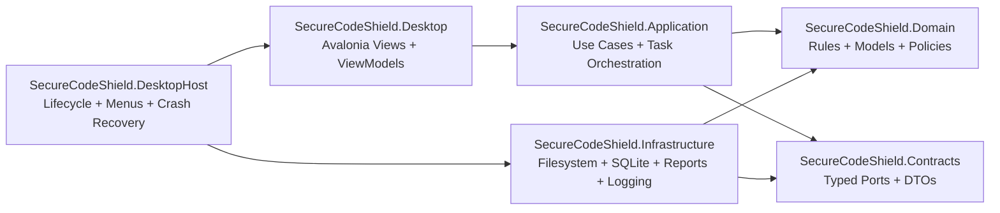
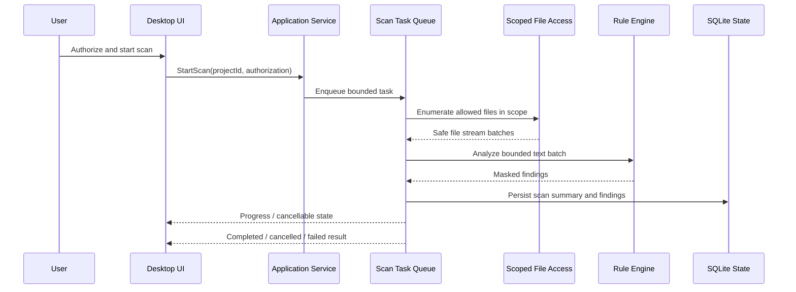

# Secure Code Shield — Production Architecture

**Status:** Architecture baseline for a clean rebuild. No previous Electron prototype source is reused.
**Product:** CyberBank Secure Code Shield.
**Primary platform:** Windows desktop.
**Product model:** Local-first, user-authorized code security review workstation.

## 1. Executive Decision

Secure Code Shield will be rebuilt as a **desktop-first Avalonia application on .NET**, using XAML, MVVM, and a native-rendered control tree rather than a browser-style renderer. Avalonia uses its own rendering engine and provides desktop controls, data binding, accessibility, and keyboard navigation, which makes it a better fit for the approved workstation experience than repeating a WebView-based shell.[1]

The first release is deliberately narrow. It reviews a local project that the user explicitly authorizes, detects a curated set of redacted secret indicators and dependency-manifest risks, presents reviewable findings, and exports a clean report. It does not execute source files, upload code, inspect remote targets, promise a complete vulnerability assessment, or store raw secrets.

> **Acceptance principle:** a feature is not “done” because it appears on screen. It is done only when its domain behavior, failure behavior, Windows workflow, privacy boundary, and recovery behavior are verified.

## 2. Product Boundary

| Concern | Included in Version 1 | Explicitly excluded |
|---|---|---|
| Project review | A user-selected local folder, canonicalized and authorization-gated | Network drives by default, remote repositories, arbitrary host paths |
| Analysis | Secret indicators, configuration hygiene, and supported dependency manifests | Exploit execution, active scanning, credential validation, code execution |
| Findings | Severity, rule, relative path, line, masked evidence, remediation, decision state | Raw secret values, source-file copies, absolute paths in export |
| Storage | Versioned local project manifest, encrypted-at-rest optional future setting, local SQLite state | Cloud synchronization, customer-code upload, raw-secret persistence |
| Reports | Sanitized Markdown, JSON, and printable HTML/PDF later | Full source bundles or unredacted proof-of-secret exports |
| Desktop UX | Project switcher, explorer, scan queue, results table, inspector, activity, keyboard shortcuts | Marketing/landing layouts or undocumented hidden actions |

## 3. Architecture Overview

The system uses a strict inward dependency direction. The desktop UI consumes application contracts. The application layer consumes domain policies. Infrastructure implements file access, SQLite, report writing, logging, and background work behind interfaces. No domain rule imports Avalonia, filesystem APIs, or UI types.



## 4. Repository Structure

```text
secure-code-shield/
├── SecureCodeShield.sln
├── Directory.Build.props
├── Directory.Packages.props
├── docs/
│   ├── architecture/
│   ├── adr/
│   ├── threat-model/
│   ├── runbooks/
│   └── release-notes/
├── src/
│   ├── SecureCodeShield.Domain/
│   │   ├── Findings/
│   │   ├── Projects/
│   │   ├── Policies/
│   │   ├── Scans/
│   │   └── Reports/
│   ├── SecureCodeShield.Application/
│   │   ├── Commands/
│   │   ├── Queries/
│   │   ├── Tasking/
│   │   └── Validation/
│   ├── SecureCodeShield.Contracts/
│   │   ├── FileSystem/
│   │   ├── Persistence/
│   │   ├── Reporting/
│   │   └── Telemetry/
│   ├── SecureCodeShield.Infrastructure/
│   │   ├── LocalFiles/
│   │   ├── Sqlite/
│   │   ├── Reports/
│   │   ├── Logging/
│   │   └── Recovery/
│   ├── SecureCodeShield.Desktop/
│   │   ├── Views/
│   │   ├── ViewModels/
│   │   ├── Controls/
│   │   ├── Themes/
│   │   └── Assets/
│   └── SecureCodeShield.DesktopHost/
│       ├── Lifecycle/
│       ├── Menus/
│       ├── Shortcuts/
│       └── Startup/
├── tests/
│   ├── SecureCodeShield.Domain.Tests/
│   ├── SecureCodeShield.Application.Tests/
│   ├── SecureCodeShield.Infrastructure.IntegrationTests/
│   ├── SecureCodeShield.Desktop.SmokeTests/
│   └── fixtures/
└── tools/
    ├── benchmarks/
    ├── packaging/
    └── test-data-generator/
```

## 5. Domain Model

The central object is a local project. A project has a stable identifier and a user-approved root path, but no source contents are stored by the product. Every scan is an immutable execution record. Findings are keyed by a deterministic fingerprint derived from rule ID, normalized relative location, and masked evidence hash; the fingerprint allows differential scanning without retaining the raw match.

| Entity | Essential fields | Privacy requirement |
|---|---|---|
| `Project` | ID, display name, approved root path, policy profile, created/updated timestamps | Root path remains local and is never included in exported reports |
| `ScanRun` | ID, project ID, start/end, engine version, outcome, counters, cancellation marker | Stores counts and safe timings, never source text |
| `Finding` | Fingerprint, rule ID, severity, relative path, line/column, masked evidence, remediation | Evidence is masked before object creation and raw match is discarded |
| `FindingDecision` | Finding fingerprint, state, reason, actor-local timestamp | Supports reviewed/ignored/false-positive workflows without deleting history |
| `PolicyProfile` | Included rules, exclusions, file-size limits, extension allowlist | Validation rejects unsafe or overly broad policies |
| `TaskRecord` | Task ID, state, progress, started/ended, failure category | Contains no source text and enables recovery/status UI |

### Persistence

Each project receives a versioned manifest file (`.scshield/project.json`) holding only project metadata and policy selection. Application-level state lives in a SQLite database under the user’s local app-data directory, using schema migrations, `WAL` mode, integrity checks on startup, atomic backups before migrations, and a recovery flow that preserves the corrupt database for diagnostics while rebuilding a clean local store.

The database has tables for projects, scan runs, findings, decisions, policy profiles, task records, migrations, and audit events. It does **not** contain raw match values, source-file bodies, or external credentials. Project exports use a new generated report folder; existing reports are never silently overwritten.

## 6. Local Filesystem Security Model

The app has one filesystem authority: `IProjectFileAccess`. The UI cannot open arbitrary files. A native folder picker returns a candidate root; the application canonicalizes it, stores the user’s explicit authorization, and creates a scope token. Every later read checks that the resolved path remains inside that canonical root. Symbolic links, junctions, and reparse points that escape the root are skipped and recorded as a safe audit event.

| Control | Enforcement |
|---|---|
| Explicit authorization | Required on every new project and when a root changes |
| Canonical containment | Resolve and compare full paths before opening each file |
| File allowlist | Text/source/config/manifest extensions only; binaries and unknown types ignored |
| Size limits | Default per-file and per-scan byte caps; explicit warning before policy expansion |
| Directory exclusions | `node_modules`, `.git`, build output, package caches, and user policy exclusions skipped by default |
| No execution | Files are read as bounded text streams only; never evaluated or passed to shells |
| Evidence masking | Match value is transformed to a mask before it crosses the rule-engine boundary |

## 7. Analysis Pipeline

Analysis runs in a bounded background queue and never on the UI dispatcher. A single scan has a cancellation token, a progress channel, a structured failure result, and a cleanup/finalization path. The UI receives task-state snapshots; it never owns file handles or raw source buffers.



The initial ruleset remains intentionally small and explainable. It covers secret-like assignments in supported configuration/source files, insecure placeholder configuration, and dependency manifests with guidance that is clearly labelled as manifest review—not a claim of live CVE resolution. New rule families require a threat-model note, deterministic fixtures, false-positive analysis, and a migration-safe rule version.

## 8. Desktop Experience

The UX follows the approved CyberBank workstation grammar. The left application rail contains Dashboard, Projects, Scans, Findings, Reports, Policies, and Settings. The second pane is a project explorer and contextual file tree. The center workspace holds scan summary cards and a dense findings table with filtering, search, bulk decision actions, and pagination/virtualization. The right inspector shows a safe redacted snippet, rule explanation, remediation, evidence metadata, and decision history. A bottom activity area shows task progression, scan phases, and engine health.

The splash and loading sequence use the approved dark segmented globe and restrained GitHub-blue accent, while the operational workspace uses GitHub Dark surfaces and avoids decorative imagery. Every screen has a purposeful empty, loading, error, and success state. Global actions are available through a command palette. Required shortcuts include `Ctrl+K` for commands, `Ctrl+N` for new scan, `Ctrl+E` for export, `Escape` to cancel a focused task or dialog, and standard table navigation keys.

## 9. Performance Model

The performance target is a responsive UI under a project containing thousands of eligible files. Enumeration, file reads, parsing, hashing, and persistence are off the UI thread. Work uses bounded concurrency based on a conservative CPU/memory budget. Text is processed as streams with byte ceilings; large files are skipped with an explicit reason. Finding lists use incremental page loading and row virtualization, while detail inspection is lazy.

| Target | Version 1 acceptance metric |
|---|---|
| Startup | Main shell interactive within 2 seconds on a baseline Windows developer machine, excluding first-run migration |
| UI responsiveness | No task may block the UI dispatcher for more than 16ms continuously |
| Cancellation | A queued or running scan reports cancellation within 500ms after the current bounded read batch |
| Memory | Scan buffers have a hard configurable cap and are released when each file batch completes |
| Large projects | Eligible-file queue is bounded; no unbounded in-memory file list or source cache |
| Differential scan | Unchanged eligible files reuse safe fingerprints; changed files are reanalyzed |

## 10. Security and Privacy Threat Model

| Threat | Mitigation |
|---|---|
| Malicious project path | Canonical containment checks, reparse-point handling, approved-root token |
| Huge/binary file denial of service | Extension allowlist, byte caps, stream processing, cancellation |
| Raw-secret persistence | Mask before finding construction; prohibit raw string fields in persistence/report contracts |
| Report disclosure | Relative paths only, masked evidence, report preview before export, no absolute root path |
| UI process abuse | No direct filesystem access in view models; all operations flow through typed application services |
| Database corruption | SQLite migrations, pre-migration backup, integrity check, recoverable quarantine workflow |
| Crash during scan | Task state persisted as interrupted; restart marks task incomplete and offers safe rescan |
| Sensitive logs | Structured logger filters source/evidence fields and uses local rotating logs only |

## 11. Testing Strategy

Every behavior begins with a failing test. The test pyramid includes pure domain tests, application orchestration tests with real temporary filesystem fixtures, SQLite integration tests, and Windows desktop smoke tests. Fixtures contain synthetic values only; no real secrets, customer code, or copied repositories are ever committed.

| Layer | Examples |
|---|---|
| Domain unit tests | Masking, fingerprinting, severity policy, decision transitions, rule validation |
| Application tests | Authorization rejection, cancellation, bounded queue behavior, differential scan, safe report contract |
| Infrastructure integration tests | Canonical path containment, symlink escape rejection, SQLite migration/backup/recovery, atomic export |
| Failure tests | Corrupt project manifest, unreadable file, cancelled task, file removed mid-scan, database locked |
| Desktop smoke tests | Cold start, splash-to-shell transition, open project, authorization gate, start/cancel scan, inspect finding, export safe report |
| Performance tests | Thousands of synthetic paths, large-file skip, bounded-memory scan, virtualized finding list |

## 12. Release Engineering

The first Windows alpha will be produced as an MSIX or signed installer decision after a packaging spike; the package must not rely on manual copying. Each build gets semantic versioning, a build manifest, release notes, installer test evidence, and a rollback path to the prior signed package. Crash reporting is local and opt-in at first; any future remote telemetry requires a separate privacy decision and no source/evidence payload.

## 13. Delivery Phases

| Phase | Output | Gate |
|---|---|---|
| A. Foundation | Solution, dependency rules, architecture decision records, synthetic fixtures, CI checks | Architecture review and clean build |
| B. Core engine | Authorization, scoped access, masking, basic rules, task queue, SQLite state, tests | All core/failure tests pass |
| C. Desktop shell | Avalonia host, native menus, lifecycle, command palette, safe dialogs, crash recovery | Windows smoke test passes |
| D. Workstation UI | Approved analyst shell, explorer, findings grid, inspector, activity/status states | Visual review against design guide |
| E. Reliability | Differential scanning, policies, reports, performance benchmarks, recovery flows | Target metrics and failure tests pass |
| F. Windows alpha | Installer, release notes, signing preparation, manual QA checklist | Clean install and workflow evidence |

## 14. Hard Decisions Resolved

The product will **not** attempt to become a full security scanner in Version 1; that would dilute reliability and create unsafe expectations. It will **not** include Telegram or Discord; they are future operational channels, not core product scope. It will **not** reuse the deleted Electron prototype code. It will choose native-rendered Avalonia controls for the new desktop shell, while preserving a clean C# domain model that could later be hosted in a different shell without rewriting the analysis engine.

## References

[1]: [Avalonia Documentation — Welcome](https://docs.avaloniaui.net/docs/welcome)
